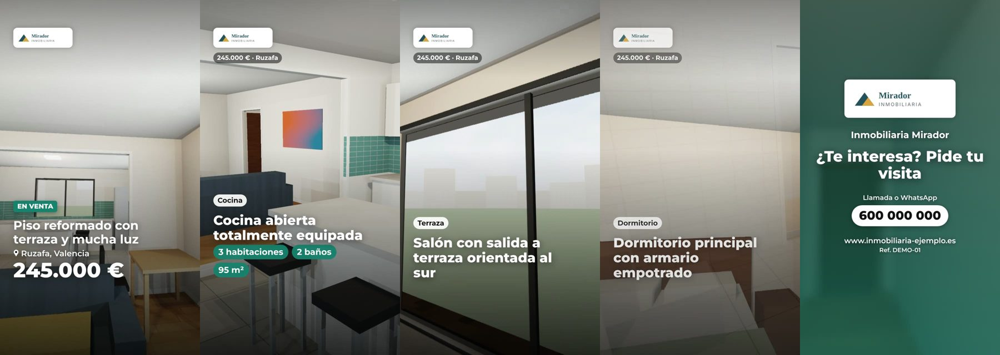
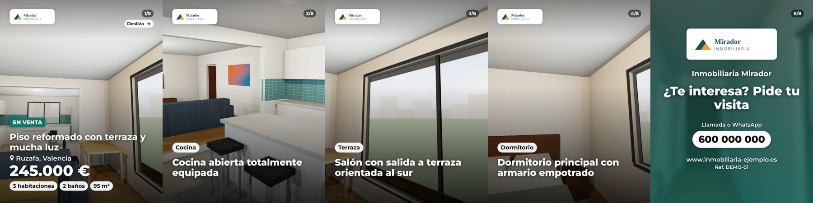
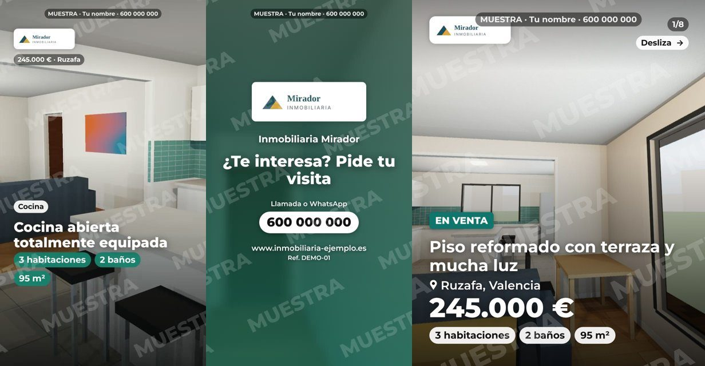

# Kit Inmueble · vídeos y carruseles para inmobiliarias

Servicio para vender a inmobiliarias locales: con las fotos que ya tienen en su anuncio, les entregas en 24 h un **kit de redes por inmueble** con su marca (Reel 9:16, vídeo 16:9, carrusel 4:5, story y texto de publicación). Lo fabricas en minutos con el generador de esta carpeta, que funciona dentro del navegador: **0 €, sin servidor, sin cuentas y sin subir nada a ningún sitio**.



## Empieza aquí

| Orden | Documento | Para qué |
|---|---|---|
| 1 | [negocio/01-decision-y-evidencia.md](negocio/01-decision-y-evidencia.md) | Por qué esta oportunidad, con fuentes; qué es un hecho y qué es una hipótesis |
| 2 | [negocio/02-oferta-y-precios.md](negocio/02-oferta-y-precios.md) | Qué vendes, a cuánto y cómo lo entregas |
| 3 | [negocio/03-plan-primer-cliente.md](negocio/03-plan-primer-cliente.md) | **Plan de 7 días para el primer cobro** |
| 4 | [negocio/04-guion-visita-y-objeciones.md](negocio/04-guion-visita-y-objeciones.md) | Qué decir en la agencia y cómo responder a las objeciones |
| 5 | [negocio/05-mensajes-whatsapp.md](negocio/05-mensajes-whatsapp.md) | Mensajes de seguimiento, entrega y cobro |
| 6 | [negocio/06-legal-y-cobro.md](negocio/06-legal-y-cobro.md) | Alta, IVA, factura y qué canales están prohibidos (léelo antes de cobrar) |
| 7 | [negocio/07-canales-secundarios.md](negocio/07-canales-secundarios.md) | Instagram, Fiverr, Workana y grupos de agentes |
| — | [negocio/prospectos.csv](negocio/prospectos.csv) | Lista de agencias y seguimiento del embudo |
| — | [negocio/hoja-de-precios.html](negocio/hoja-de-precios.html) | Hoja A4 para dejar en la agencia (escribe tus datos e imprime) |

## El generador

**Cómo abrirlo (elige una):**

1. **En el ordenador:** descarga [`generador.html`](generador.html) (en GitHub: botón «Download raw file») y ábrelo con doble clic en **Chrome o Edge**. Es un único archivo que funciona sin conexión, salvo la tipografía.
2. **Desde claude.ai:** se ha publicado como página privada (Artifact «Kit Inmueble»). Sirve en cualquier dispositivo; las descargas piden confirmación.

Si arriba a la derecha pone **«Navegador compatible: vídeo MP4 rápido»**, el vídeo se genera más rápido que en tiempo real. En otros navegadores se graba en tiempo real o en WebM. Safari reciente también suele ser compatible.

**Uso:**

1. **Fotos:** arrástralas (la primera es la portada). En cada una puedes escribir la estancia y un punto fuerte.
2. **Datos:** venta o alquiler, precio, título, zona, habitaciones, baños, m² y referencia.
3. **Inmobiliaria:** nombre, logo, color, teléfono, WhatsApp y web. Pulsa **«Guardar perfil»** y el siguiente kit de esa agencia te costará la mitad de tiempo.
4. **Opciones:** idioma (ES/EN), estilo, segundos por foto, calidad y **«Muestra con marca de agua»** (para enseñar a una agencia antes de cobrar).
5. Genera **Reel MP4**, **Vídeo 16:9 MP4**, **Carrusel + story** o **Todo en un ZIP**, y copia el texto de la publicación.

**Qué produce:** MP4 H.264 a 30 fps en 1080×1920 y 1920×1080 (o 720p en el modo ligero), JPG 1080×1350 para el carrusel, story 1080×1920, texto con hashtags de la zona y un ZIP con todo. Las fotos no se alteran: solo hay montaje, movimiento, textos y marca.

## Muestras

- `muestras/fotos-demo/`: 7 fotos de una vivienda de demostración. Son renders propios extraídos de las panorámicas 360° de `simulador-visitas/`, así que no tienen derechos de terceros. Úsalas para practicar y para tu portfolio.
- `muestras/demo/reel-demo-720p.mp4`: Reel generado con esas fotos.
- `muestras/demo/vista-*.jpg`: fotogramas del Reel, del vídeo 16:9, del carrusel y de la versión con marca de agua.

| Vídeo 16:9 | Carrusel | Muestra con marca de agua |
|---|---|---|
|  |  |  |

## Para desarrolladores

```
generador/index.html        interfaz (carga los scripts de src/)
generador/src/render.js     composición de fotogramas: Ken Burns, barridos, textos, marca de agua
generador/src/encode.js     MP4 con WebCodecs + mp4-muxer (con respaldo de MediaRecorder)
generador/src/zip.js        ZIP sin compresión, sin dependencias
generador/src/i18n.js       textos del vídeo (ES/EN) y texto de la publicación
generador/src/app.js        formulario, perfiles, vista previa y exportación
generador/vendor/           mp4-muxer 5.2.2 (licencia MIT, incluida)
scripts/build.mjs           genera generador.html (archivo único); --artifact <salida> para claude.ai
scripts/test-e2e.mjs        prueba completa en Chromium + ffprobe/ffmpeg
scripts/extraer-vistas-360.py  saca fotos «normales» de panorámicas 360°
```

```bash
node kit-inmuebles/scripts/build.mjs                       # después de tocar generador/
node kit-inmuebles/scripts/test-e2e.mjs /tmp/salida         # añade --720 o --muestra para otras variantes
```

La prueba carga las 7 fotos de demostración, rellena el formulario, guarda un perfil y genera los cuatro tipos de salida. Después comprueba con ffprobe y ffmpeg que los MP4 son H.264, tienen el tamaño y la duración correctos y se decodifican sin errores. También verifica que el ZIP está íntegro, que no hay scroll horizontal a 390 px y que no hay errores de JavaScript. Último resultado: Reel y vídeo 16:9 de 1080p y 18,9 s, cada uno generado en unos 20 s con Chromium sin GPU.

**Valores de `estado` en `prospectos.csv`:** `pendiente`, `muestra`, `visitada_sin_decisor`, `conversacion`, `interesado`, `pedido`, `entregado`, `cobrado`, `no_interesa`, `no_contactar`.
